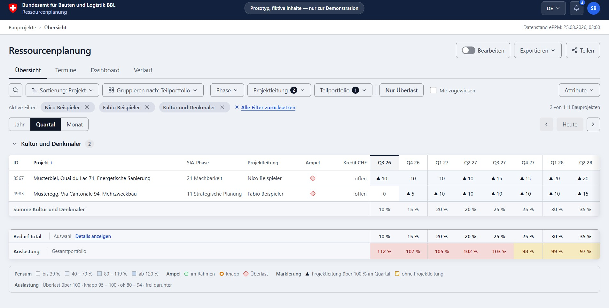
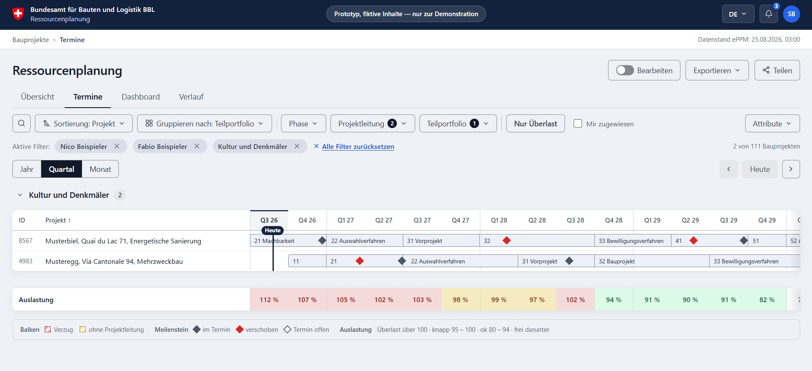

# BBL Resource Planning (Ressourcenplanung)

<p align="center">
  <a href="https://bbl-dres.github.io/resource/">
    
  </a>
</p>

[](https://bbl-dres.github.io/resource/)
[](LICENSE)

> [!CAUTION]
> This is an unofficial demonstration prototype with fictional people, projects, and operational data. Edits remain in browser memory, the API view is a reference rather than a live service, and the app is not intended for production use.

Resource-planning prototype for the [Federal Office for Buildings and Logistics (BBL)](https://www.bbl.admin.ch), connecting project demand, schedules, milestones, project leads, and team capacity.

## Demo

**Live demo:** https://bbl-dres.github.io/resource/

<p align="center">
  
  
</p>

## Features

- Review the portfolio in one planning grid that shows workload figures, the phase schedule, or both in the same rows, plus dashboards and a change history.
- Fold a project open to its roles — Bearbeitender, Stellvertretung, Bauleitung, Fachplanung — one row per role and person, read from SAP ePPM — and type the workload per quarter straight into the cells, as in a spreadsheet. See [`docs/ROLES.md`](docs/ROLES.md).
- Read the projects by size — small before large — and filter and sort year, quarter, and month views in percent or FTE.
- Compare demand, capacity, utilisation, free capacity, and person-level workload.
- Export CSV, Excel, and client-side PDF reports and print schedules from A4 through A0.
- Use the responsive interface in German, French, Italian, or English.

## Run locally

The app loads static JSON fixtures, so serve the repository over HTTP:

```bash
python -m http.server 8000
```

Then open <http://localhost:8000/>.

To check the fixtures and the model without a browser — Node 22.7 or later, no dependencies:

```bash
node tools/check.mjs
```

## Documentation

- [Architecture](docs/ARCHITECTURE.md) — code structure, state, rendering, grids, time, exports, and data.
- [Data model](docs/DATAMODEL.md) — the entities in `data/`, their fields, and how they join.
- [Roles](docs/ROLES.md) — several people per project: what is built, and what the feedback round changed.
- [Code review, November 2026](docs/reviews/2026-11-16-code-review.md) — findings, what was fixed, and what is still open.
- [Consistency review](docs/reviews/2026-11-17-consistency-review.md) — which switch and which link parameter changes which tab, the print layout and the files.
- [Design review](docs/reviews/2026-11-17-design-review.md) — tokens, shared styles, screens from phone to meeting-room wall, accessibility.
- [Data generator](tools/README.md) — deterministic fixture generation and known data limitations.

Earlier retrospectives are retained in [`docs/archive/`](docs/archive/) for historical context.

## License

Original project code is licensed under the [MIT License](LICENSE). Lucide icons are ISC-licensed, and vendored Swagger UI remains under its upstream terms.
